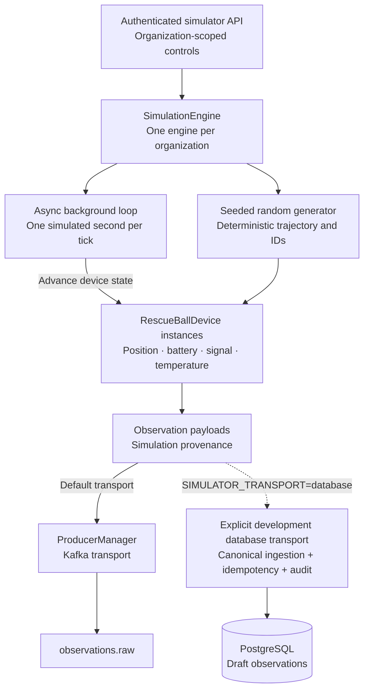

# Rescue-Ball Simulator

> **DIGITAL SIMULATION** — The physical rescue ball, its mobility, communications,
> thermal accuracy, and landing mechanism have **NOT** been validated. This module
> models a notional spherical rescue device deployed into flooded urban areas for
> situational awareness. All simulator output is synthetic and must not be used as
> a basis for real-world rescue decisions.

The simulator is a deterministic digital twin of a rescue ball, a notional
spherical device deployed into flooded urban areas for situational awareness.
It produces synthetic sensor observations (battery, temperature, signal,
altitude) and publishes them to the `observations.raw` Kafka topic, matching
the payload format expected by the streaming consumer. The explicitly configured
development database transport persists draft observations locally without Kafka.

## Architecture



Each tick (1 second):
1. Every device advances state: position, battery, signal, temperature, IMU, acoustic
2. Four observations published per device: battery_level, device_temperature,
   signal_quality, altitude
3. Observation IDs are deterministic ULIDs derived from the RNG and timestamp
4. Payloads carry `provenance_chain: {"simulated": true}` for downstream filtering

## API

All endpoints are under `/api/simulator`. Start, stop, pause, resume, speed changes, and inject-fault require
`admin` or `emergency_manager` roles. Status is available to any authenticated user.

### Start the simulation

```bash
curl -sf -X POST http://localhost:8000/api/simulator/start \
  -H "Authorization: Bearer $TOKEN" \
  -H "Content-Type: application/json" \
  -d '{
    "org_id": "org_demo",
    "incident_id": "01J...",
    "device_count": 2,
    "seed": 42
  }' | jq .
```

Returns 202 with `device_ids` (e.g. `["rescue-ball-001", "rescue-ball-002"]`).
`device_count` must be 1-10. The same `seed` always reproduces the same
trajectory and observation IDs.

### Check status

```bash
curl -sf -H "Authorization: Bearer $TOKEN" \
  http://localhost:8000/api/simulator/status | jq .
```

Returns:

```json
{
  "state": "running",
  "device_count": 2,
  "speed": 1.0,
  "seed": 42,
  "sim_time_ms": 45000,
  "device_ids": ["rescue-ball-001", "rescue-ball-002"]
}
```

### Stop the simulation

```bash
curl -sf -X POST http://localhost:8000/api/simulator/stop \
  -H "Authorization: Bearer $TOKEN"
```

Returns 204. Cancels the background task and stops the Kafka producer.

## Fault injection

Inject faults into a specific device to test downstream behavior. Each fault
is deterministic and modifies the device in place.

```bash
curl -sf -X POST http://localhost:8000/api/simulator/inject-fault \
  -H "Authorization: Bearer $TOKEN" \
  -H "Content-Type: application/json" \
  -d '{
    "device_id": "rescue-ball-001",
    "fault_type": "battery_drain",
    "kwargs": {"rate": 30.0}
  }' | jq .
```

### Available fault types

| Fault type | Parameters | Effect |
|---|---|---|
| `battery_drain` | `rate: float` | Subtract `rate` % from battery immediately |
| `sensor_degradation` | `sensor: "camera" \| "thermal"` | Set sensor status to `degraded` |
| `connectivity_loss` | `duration: int` (seconds) | Signal to 0, packet_loss to 100, link to `none` |
| `blocked_route` | `alternative_heading: float` (degrees) | Change heading to bypass block |
| `thermal_hotspot` | `temperature: float` (°C) | Record hotspot in `health_flags` |
| `human_heat_signature` | `location: str` | Record human heat signature in `health_flags` |
| `water_depth` | `depth: float` (meters) | Record depth in `acoustic_reading` |
| `motion` | `direction: float` (degrees) | Record motion heading in `imu_reading` |
| `vibration` | `intensity: float` (m/s²) | Record vibration in `imu_reading` |
| `environmental_temp` | `temp: float` (°C) | Set device temperature |

## CLI usage

The simulator runs as a background asyncio task inside the FastAPI process.
There is no standalone CLI. Use the API or the demo script:

```bash
make demo   # runs scripts/demo_phase1.sh which starts/stops the simulator
```

## Seed data

The seed script (`app.seed.seed_demo`) creates 2 rescue-ball device records
in the database with deterministic IDs. These are entity records, not live
simulator instances. The simulator creates live `RescueBallDevice` objects
in memory when `start()` is called.

The Rivertown flood path is a notional trajectory through 8 waypoints:

| Waypoint | lon | lat | altitude | Description |
|---|---|---|---|---|
| 0 | 72.8500 | 19.0720 | 5.0 | Deployment point (riverside) |
| 1 | 72.8520 | 19.0700 | 4.0 | Entering flood zone |
| 2 | 72.8550 | 19.0680 | 2.0 | Ward 1, shallow flood |
| 3 | 72.8580 | 19.0650 | 0.5 | Ward 2, moderate flood |
| 4 | 72.8620 | 19.0630 | -1.0 | Ward 3, deep flood |
| 5 | 72.8650 | 19.0620 | -1.5 | Basin center |
| 6 | 72.8680 | 19.0630 | -1.0 | Exiting basin |
| 7 | 72.8700 | 19.0650 | 0.0 | Recovery zone |

Devices are placed at successive waypoints. Negative altitudes indicate
below-sea-level flooded zones.

## Device state model

Each `RescueBallDevice` tracks:

- **Position**: lon, lat, altitude (random walk with Gaussian perturbation)
- **Battery**: 0-100%, drains by deployment state (deployed: 0.005%/s, standby: 0.001%/s)
- **Signal**: quality 0-100, packet_loss 0-100, link_type (wifi/lte/satellite/none)
- **Temperature**: relaxes toward equilibrium by deployment state (deployed: 38°C)
- **Sensors**: camera, thermal, IMU (6-axis), acoustic (dB + frequency)
- **Health flags**: low_battery, critical_battery, high_temp, signal_loss,
  enclosure_breached, camera_offline, thermal_sensor_offline
- **Deployment state**: deployed, standby, recovered, lost

## Determinism

All randomness is sourced from a caller-provided `random.Random`. The same
seed reproduces:

- The same device trajectories (position over time)
- The same observation IDs (deterministic ULIDs from RNG + timestamp)
- The same sensor readings (Gaussian noise from the same RNG state)

This makes the simulator reproducible for testing and demo purposes. Change
the seed to get a different scenario.

## Kafka integration

Observations are published to `observations.raw` via `ProducerManager`. The
payload matches the consumer's expected format:

```json
{
  "observation_id": "01J...",
  "event_type": "sensor_observation",
  "phenomenon": "battery_level",
  "geometry": {"type": "Point", "coordinates": [72.855, 19.068]},
  "observed_at": 45000,
  "source_id": "simulator:rescue-ball-001",
  "source_type": "sensor",
  "org_id": "org_demo",
  "incident_id": "01J...",
  "value": 78.5,
  "unit": "%",
  "provenance_chain": {"simulated": true},
  "raw_data_hash": "sha256:..."
}
```

If Kafka is unavailable, the engine logs a warning and continues. Observations
are not published, but the simulation loop keeps running. The `provenance_chain`
field carries `{"simulated": true}` so downstream consumers can filter out
simulated data in production deployments.

## Simulation disclaimer

**DIGITAL SIMULATION** — The rescue-ball simulator is a software model of a
notional physical device. The physical rescue ball, its mobility, communications,
thermal imaging accuracy, and landing mechanism have **NOT** been validated
against real hardware. The simulator produces synthetic data for development,
testing, and demonstration purposes only. It must not be used as a basis for
real-world rescue or emergency response decisions. See
[KNOWN_LIMITATIONS.md](KNOWN_LIMITATIONS.md) for the full list of disclaimers.
